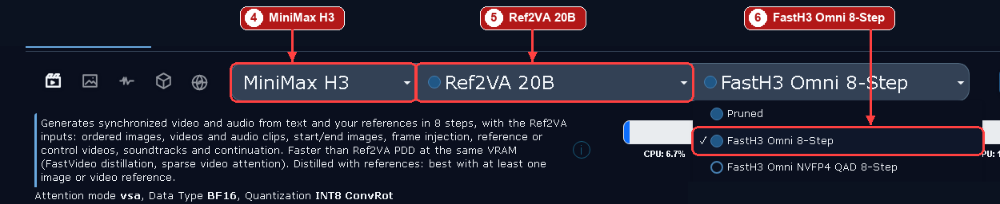
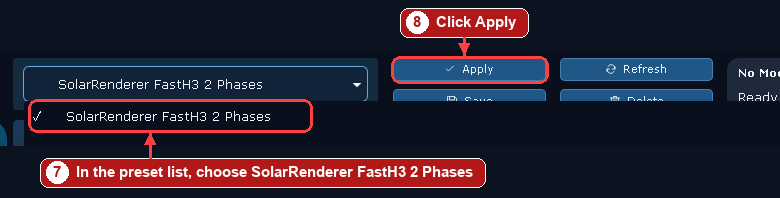
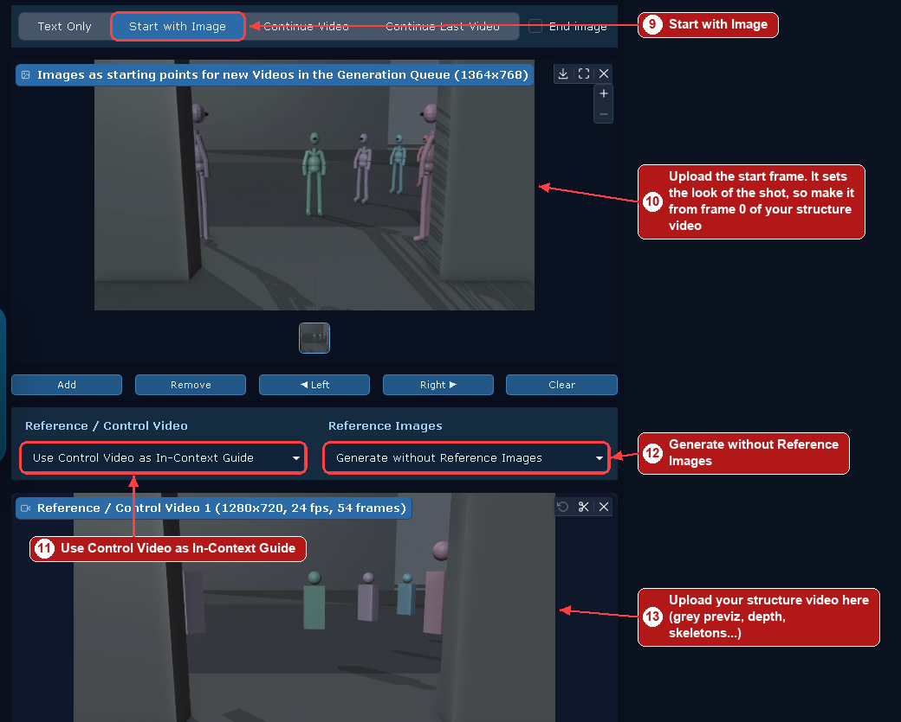
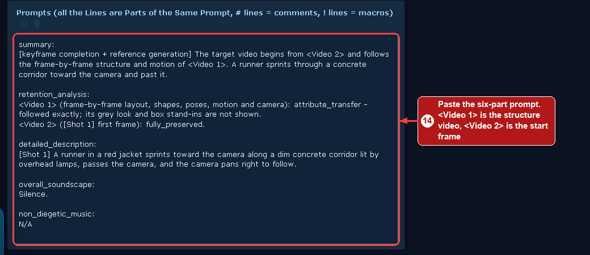
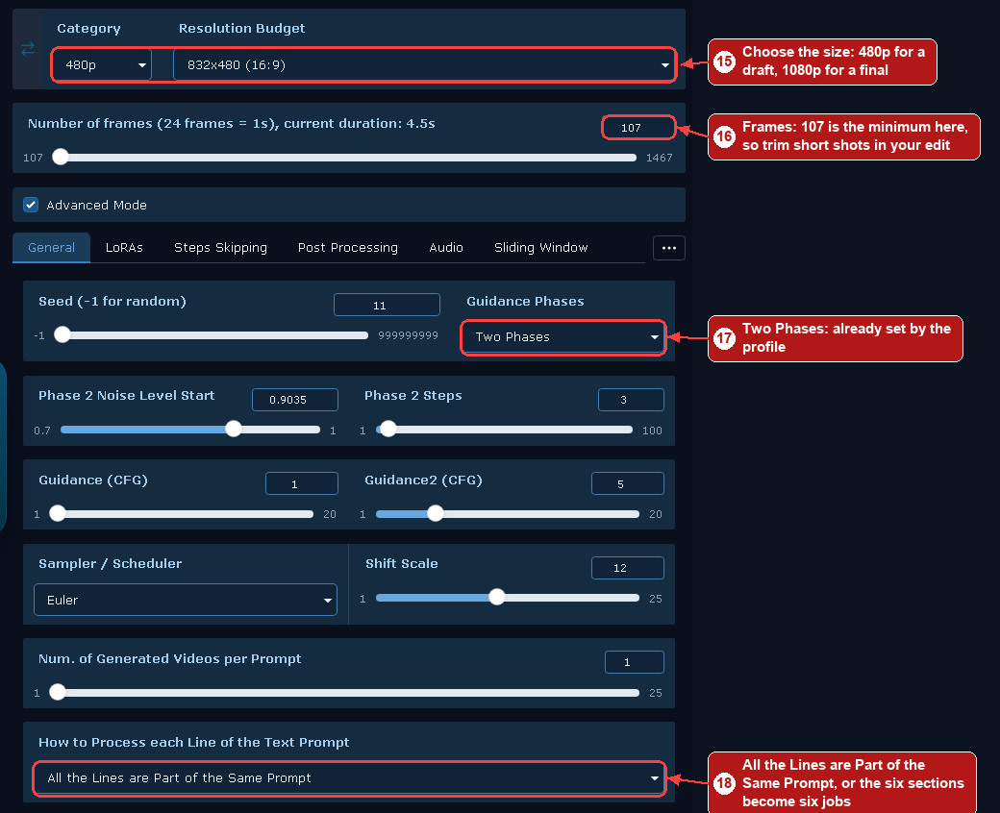

# wan2gp-solar-renderer

**Run [SolarRenderer](https://github.com/Enderfga/SolarRenderer) inside [WanGP](https://github.com/deepbeepmeep/Wan2GP), with no ComfyUI and no changes to WanGP's core.**

**SolarRenderer links:** [home page](https://enderfga.cn/SolarRenderer/) · [code](https://github.com/Enderfga/SolarRenderer) · [paper](https://arxiv.org/abs/2610.28630) · [weights](https://huggingface.co/Enderfga/SolarRenderer)

SolarRenderer turns a structure video (a grey box previz, depth, skeletons, a segmentation, a game's frames) into a finished video that follows it frame by frame, on MiniMax H3 in a few steps. This plugin also adds **Two Phases to FastH3 Omni**, which WanGP normally locks to one phase.

This is an unofficial community plugin, not affiliated with the SolarRenderer authors, MiniMax or WanGP.

## Why a plugin and not just the LoRAs

SolarRenderer's two LoRAs load in WanGP on their own, but alone they drift off the structure. They were trained with a specific sampling setup, and this plugin applies it:

1. The structure video and first frame are laid frame-aligned over the target.
2. The prompt encoder sees them as `<Video 1>` and `<Video 2>` at 2 fps.
3. Four model evaluations with fresh noise between them (video shift 12, audio shift 3) on regular H3. FastH3 Omni keeps its own 8 Euler steps.
4. The soundtrack is held at H3's encoded silence.

## Requirements

- WanGP with MiniMax H3 (tested on **v19.10**, RTX 4090 24 GB, 128 GB RAM)
- A MiniMax H3 Ref2VA model, or FastH3 Omni (both come through WanGP)
- The two LoRAs from [Enderfga/SolarRenderer](https://huggingface.co/Enderfga/SolarRenderer), about 4.15 GB each. The included profiles point at them.

## Install

### From WanGP


1. Open **Apps & PlugIn Manager**.
2. Open **Install from URL** and paste `https://github.com/hoodtronik/wan2gp-solar-renderer`.
3. Click **Download and Install from URL**. You should see "Plugin 'wan2gp-solar-renderer' installed. It has been auto-enabled." Restart WanGP.

If it loaded, the console prints `[H3 SolarRenderer] active`.

### By hand

```bash
cd <WanGP app>/plugins
git clone https://github.com/hoodtronik/wan2gp-solar-renderer
```

Then enable **H3 SolarRenderer** in the manager and restart WanGP.

### The LoRAs

The two profiles point at the LoRAs by URL, so WanGP should fetch them on first use. If you download them yourself, put them in `loras/minimax_h3`:

- `solarrenderer_4step_lora.safetensors`
- `solarrenderer_control_lora.safetensors`

## Which lane to use

**hoodtronik's pick for previz-driven shots: regular H3 + Larry v4 at 8 steps + this mix.** In side-by-sides it beat every FastH3 option here, at 480p and at 1080. Use profile **SolarRenderer Larry 8 Steps 2 Phases**, or `--larry` headless.

| Setting | Value |
|---|---|
| Model | MiniMax H3 Ref2VA Pruned |
| LoRAs (phase 1;phase 2) | Larry v4 `1;0`, 4-step `1;0`, control `1;1` |
| Steps | 8 + 3 phase-2 steps, Euler, flow shift 12, guidance 1, Two Phases |
| Sizes | 864x480 draft, 1920x1080 final |

Measured at 107 frames, including model load: 105-116 s at 480p, 332-415 s at 1080. It is 2 shots and 1 seed, with no usable sound, and it has only been rendered headless so far.

**His opinion of FastH3 Omni + SolarRenderer: the walking and movement look janky.** The FastH3 profiles stay here because they are faster to try, but he does not recommend them for finished work. Plain FastH3 Omni without SolarRenderer looked solid to him at 1344x768.

Larry v4 comes from [DeepBeepMeep's H3 repo](https://huggingface.co/DeepBeepMeep/MiniMax-H3). Sampling on regular H3: 4 steps runs SolarRenderer's own re-noise schedule; any other step count keeps the job's solver and steps.

## Use

**Selecting a SolarRenderer LoRA is the switch.** Nothing else turns the mode on, and H3 jobs without them are untouched. The profile below selects what it needs.

> **Changed in 0.2.1: do not run the 4-step LoRA in Two Phases.** It lays a visible mesh over the frame, heavy at 1080. The **SolarRenderer FastH3 2 Phases** profile now uses the control LoRA only, and **SolarRenderer FastH3 1 Phase** keeps both LoRAs. If you rendered with the old profile, look at your clips at 100%: a shrunken view can hide it. Also avoid FastH3 Two Phases at 1080: see below.

The steps show FastH3 Omni with Two Phases. For regular H3, choose **Pruned** in step 6 and **SolarRenderer Larry 8 Steps 2 Phases** in step 7, or **SolarRenderer 4 Steps** on one phase.

### Choose the model and the profile





The profile is listed at the top of the preset dropdown, under **Accelerators Profiles**. WanGP confirms when it has been applied.

### Add the start frame and the structure video



Step 11 matters most. **Use One Reference Video looks right but is the wrong mode:** it is not frame-aligned, and the plugin stops the job with an error.

The start frame sets the look. In the picture it is grey only because this is a test, and a grey start frame gives you grey frames.

### Write the prompt



SolarRenderer was trained on a six-part prompt, and upstream calls it the single biggest lever on quality. Write it with the [`solarrenderer-caption`](https://github.com/Enderfga/SolarRenderer/tree/main/skills/solarrenderer-caption) skill in their repository. Your structure video is `<Video 1>` and your start frame is `<Video 2>`.

### Check the settings, then generate



These are under **Advanced Mode**. Click **Generate**. To confirm the job really ran in this mode, see Troubleshooting.

### Settings through the API

| Setting | Value |
|---|---|
| Model | `minimax_h3_fasth3_omni`, or `minimax_h3_ref2va_pruned` |
| LoRAs | One phase: both at 1.0. Two Phases: control LoRA only, `1;1` |
| Video | `video_prompt_type` `V` or `VU`, with the structure as `video_guide` |
| Start image | `image_prompt_type` `S`, `image_start` |
| Prompt splitting | `multi_prompts_gen_type` `FG`, or the six sections become six jobs |
| Sampler | Euler. On regular H3 use 4 steps, flow shift 12, guidance 1, one phase |

### Headless

```bash
<WanGP venv python> tools/solar_render.py --wangp <WanGP app> --structure previz.mp4 --first first.png --prompt prompt.txt --out out.mp4
```

Add `--larry` for the recommended lane, `--fasth3 --phases 2` for FastH3 Two Phases (control LoRA only), and `--resolution 864x480` for a draft.

## FastH3 Omni Two Phases

WanGP locks FastH3 Omni to one phase and silently rewrites a Two Phases request back to one. The pipeline itself has phase-2 code for this kind of model, so the plugin lifts the lock. It only adds the option: FastH3 still defaults to one phase. It works with or without the SolarRenderer LoRAs.

The upstream documentation gives no reason for the lock, so treat this as unsupported. It could break on a WanGP update, or show problems on shots we did not test.

**Use it for 480p drafts, not at 1080.** FastH3 at about 1080 shows hard horizontal breaks on rows that are multiples of 128, for example a cut across a forehead. Two Phases shows them clearly, on two machines and two shots. One phase shows fewer, and they come and go by frame. No such breaks turned up in our 480p renders or on regular H3 at 1080. The cause is not established: the spacing matches FastH3's sparse attention tiles (128 px tall), but that is an inference. Check at 100%, never a shrunken view.

Check the output really ran it: `guidance_phases` in the file's embedded settings must read 2.

Measured on two shots, one take each, 107 frames at 1920x1088 or 864x480, including model load:

| Lane | Shot 1 | Shot 2 |
|---|---|---|
| FastH3 480p, one phase | 65 s | 77 s |
| FastH3 480p, Two Phases | 78 s | 68 s |
| FastH3 1080p, one phase | 327 s | not run |
| FastH3 1080p, Two Phases | 217 s | 288 s |
| FastH3 + both LoRAs 480p, one phase | 108 s | 120 s |
| FastH3 + control LoRA 480p, Two Phases | 86 s | 101 s |

Do not use these: FastH3 + both LoRAs at Two Phases took 72 s and 86 s at 480p and 303 s and 436 s at 1080p, and shows the mesh above. The two 0.2.1 rows were measured a day later on a newer WanGP, so small gaps mean little.

## Tips and limits

- **Keep the control LoRA on both phases of a Two Phases job.** With both LoRAs on phase 1 only (`1;0 1;0`), the previz flashed through briefly in our test.
- **Make the structure as long as the shot.** Past its end the render stops following anything and invents the world.
- **It follows the structure literally.** Block walls become real walls, and an empty moment in the previz becomes an empty frame. Get the previz right first.
- **Start from frame 0 of the structure.** A start frame that does not line up with it fights the render.
- **You may not need an animated character.** In a short test, a floating box with a sphere head (no limbs) still gave a fully formed runner with natural legs, moving where the box moved. Figures tended to land a little small, with their feet near the bottom of the box.
- **Colored previz was no better than grey** in our tests. Both leaked a little of the layout's look at times.
- **No usable sound.** Mute the output and add audio afterwards, so dialogue shots belong on a normal H3 lane.
- **No character references.** Identity comes from the first frame only.
- **Trained at 1344x768, 158 frames.** Other sizes work, with no guarantee. Frame counts are 17n+5. WanGP's frame slider starts at 107 for FastH3, so trim short shots in the edit. If the structure video is shorter than the render, the model carries on by itself past its end.
- **Not tested here:** the causal LoRA pair and long clips.

## Troubleshooting

- **`SolarRenderer needs H3 Ref2VA and a frame-aligned structure video`:** in the GUI, choose **Use Control Video as In-Context Guide**, not **Use One Reference Video**.
- **The render looks fine but drifts off the structure:** the mode did not run. Each job writes a line to `solar_jobs.log` in the plugin folder; no new line means it never ran. Check that both LoRA filenames still contain `solarrenderer_`.
- **`[H3 SolarRenderer] DISABLED`:** a WanGP update changed the H3 pipeline. Please open an issue with the message.
- **`Error parsing Loras Multipliers`:** on regular H3 use `1.0 1.0`. `1;1 1;1` is for Two Phases.
- **Six jobs instead of one:** set **How to Process each Line of the Text Prompt** to **All the Lines are Part of the Same Prompt** (`FG` through the API).

## What has been tested

On WanGP v19.10, starting with the plugin removed:

- Install from URL, then a restart: the plugin loads.
- Both profiles appear in the preset list and apply.
- The steps above, run through the GUI with FastH3 Omni at 832x480 and 107 frames: 70 s. The file's embedded settings read `guidance_phases` 2, `video_prompt_type` `VU`, `multi_prompts_gen_type` `FG`, and `solar_jobs.log` shows the job.

Not tested: the Larry profile and the two FastH3 profiles through the GUI (the same settings were rendered headless, 2 shots, 1 seed, judged on single frames at native size), a GUI render with **SolarRenderer 4 Steps** (regular H3 was only rendered headless), and WanGP downloading the LoRAs from the profile links. We already had the files; both links answer with the right file size.

## Licenses and credits

- **Plugin code:** Apache-2.0, see [LICENSE](LICENSE).
- **SolarRenderer** by Guian Fang, Shengju Qian, Dongyue Lu, Junchao Huang, Lutao Jiang, Xin Wang, Yiren Song, Li Jiang and Mike Zheng Shou: [project page](https://enderfga.cn/SolarRenderer/), [paper](https://arxiv.org/abs/2610.28630), [code](https://github.com/Enderfga/SolarRenderer). Their code is Apache-2.0. `assets/h3_silence_153_158_170.safetensors` comes from their repository, and the sampling setup here follows theirs. See [NOTICE](NOTICE).
- **Weights are not included.** The SolarRenderer LoRAs and MiniMax H3 are under the [MiniMax H3 Community License](https://huggingface.co/Enderfga/SolarRenderer/blob/main/LICENSE), which has territorial restrictions and an Acceptable Use Policy. Read it and make sure it covers you before you use them.
- **WanGP** by DeepBeepMeep. MiniMax H3 by MiniMax. FastH3 Omni by FastVideo.
